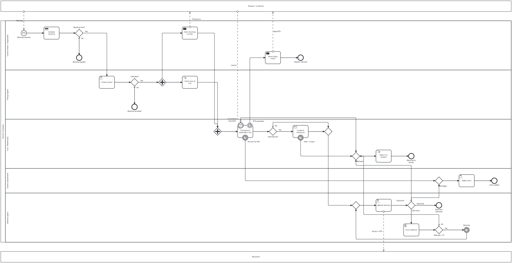
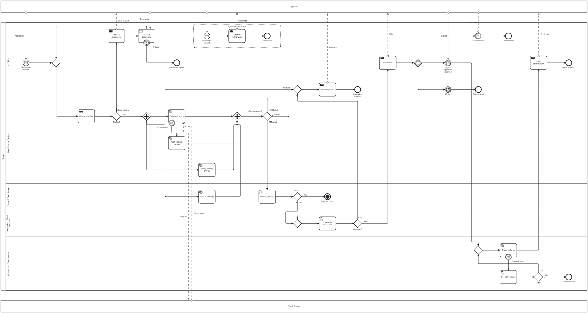

# Workflow Automation – BPMN Project Assignments

This repository contains my submission for the **BPMN Project Assignments** in the Workflow Automation course. Each process is modelled in **BPMN 2.0** and is executable on **Camunda 8**, with **DMN decision tables** for business rules and **Camunda forms** for human tasks.

The two topics I selected:

- **Assignment 2:** Logistics & Shipment Exception Management
- **Assignment 3:** Loan Origination & Approval System

For each one I drew the happy path, found the failure paths, and designed a solution for every failure inside the diagram.

## Repository structure

```
Assignment2_Logistics/
├── shipment_exception_management.bpmn   # process model
├── booking-validation.dmn               # DMN decision table
├── collect-parcel.form                  # Camunda forms
├── attempt-delivery.form
├── settle-claim.form
├── diagram.png                          # diagram screenshot
├── Logistics_Presentation.pptx          # presentation slides
└── README.md

Assignment3_Loan/
├── loan_origination.bpmn
├── loan-eligibility.dmn
├── investigate-alert.form
├── underwrite-application.form
├── fix-disbursement.form
├── diagram.png
├── Loan_Presentation.pptx
└── README.md
```

**How to open:** drag a `.bpmn` or `.dmn` file onto [demo.bpmn.io](https://demo.bpmn.io), or open the folder in **Camunda Modeler**. To run it, deploy each folder's `.bpmn`, `.dmn` and `.form` files together to Camunda 8.6+.

---

## Assignment 2: Logistics & Shipment Exception Management

### 1. Process Overview & Participants

This process models how a courier company moves a parcel from a **shipper** to a **recipient** through pickup, hubs and last-mile delivery. The focus is on how exceptions are **detected** and **resolved**.

- **Starts when:** the shipper books a shipment.
- **Ends when:** the shipment is delivered, returned to the sender, closed through a claim, or cancelled.

**External pools** (they only exchange messages with the courier):
- **Shipper / Customer:** sends the booking, receives the tracking number and delay notices, can cancel.
- **Recipient:** receives the parcel and the delivery OTP.

**Lanes inside the Courier Company pool:**
- **Control Tower / Dispatcher:** validates bookings, sends tracking and delay notices.
- **Pickup Agent:** collects the parcel and hands it over at the hub.
- **Hub / Warehouse:** transport between hubs, customs, returns to sender.
- **Claims Department:** settles claims for lost or damaged parcels.
- **Delivery Agent:** attempts delivery to the recipient.

### 2. BPMN Process Diagram



### Walkthrough & Explanation of the Diagram

- **Booking**
  - The process starts with a **message start event**, *Booking received*.
  - **Validate booking** is a **business rule task** that calls the `booking-validation` DMN table.
  - Exclusive gateway *Booking valid?*: **No** → the process ends at *Booking rejected* (**E1**).
- **Pickup**
  - **Collect parcel** is a **user task** for the Pickup Agent, using the `collect-parcel` form.
  - Exclusive gateway *Collected?*: **No** → *Booking cancelled* (**E2**).
- **Hand-over (parallel)**
  - A **parallel gateway** splits the flow:
    - **Hand over at hub** (manual task)
    - **Send tracking number** (send task to the shipper)
  - The parallel join waits for both before transport starts.
- **Transport**
  - **Transport to destination hub** is a **receive task**: the process waits for the *Arrival scan* message.
  - Three boundary events are attached to it:
    - **ETA exceeded:** non-interrupting timer → *Send delay notice* to the shipper. Transport keeps going (**E3**).
    - **No scan for 48 h:** interrupting timer → the parcel is treated as lost and goes to **Claims** (**E4**).
    - **Cancellation requested:** interrupting message from the shipper → **Return to sender** (**E5**).
- **Customs**
  - Exclusive gateway *International?*: **Yes** → **Customs clearance** (receive task) with an interrupting timer *Held > 5 days* → **Return to sender** (**E6**). **No** → skip customs.
- **Delivery**
  - **Attempt delivery** is a **user task** for the Delivery Agent, using the `attempt-delivery` form.
  - Exclusive gateway *Outcome?*:
    - **Delivered** → *Shipment delivered* (happy-path end).
    - **Not home** → **Count attempt** (script task) → *Attempts < 3?* → timer catch *Next day* → retry. After 3 attempts → **Return to sender** (**E7**).
    - **Refused / COD not paid** → **Return to sender** (**E8**).
    - **Damaged** → **Claims** (**E9**).
- **Shared handlers**
  - **Return to sender:** exclusive merge → *Return to shipper* (manual task) → *Returned to sender*.
  - **Claims:** exclusive merge → *Settle claim* (user task, `settle-claim` form) → *Claim settled*.

### 3. User Forms for Assignment 2

#### Collect Parcel Form (`collect-parcel`)
Used by the **Pickup Agent**.
- **Fields:** Shipment ID (read-only), Outcome (*Collected* / *Failed*), Notes.
- **Effect:** the outcome sets `pickupOutcome`, which the *Collected?* gateway reads.

#### Attempt Delivery Form (`attempt-delivery`)
Used by the **Delivery Agent**.
- **Fields:** Shipment ID (read-only), Outcome (*Delivered* / *Recipient not home* / *Refused / COD not paid* / *Damaged*), and Delivery OTP (shown only when *Delivered* is chosen).
- **Effect:** sets `deliveryOutcome`, which drives the *Outcome?* gateway.

#### Settle Claim Form (`settle-claim`)
Used by the **Claims Department**.
- **Fields:** Shipment ID (read-only), Payout amount (required, ≥ 0), Notes.

### 4. DMN Decision Table: Booking Validation (`booking-validation`)

- **Hit policy:** FIRST (the first matching rule wins).
- **Inputs:** `prohibitedItem` (boolean), `serviceable` (boolean), `weightKg` (number).
- **Output:** `valid` (boolean), stored in the process variable `bookingValid`.

| # | Prohibited item | Serviceable address | Weight (kg) | Valid | Meaning |
|---|---|---|---|---|---|
| 1 | true | – | – | false | Prohibited item |
| 2 | – | false | – | false | Address not serviceable |
| 3 | – | – | > 70 | false | Over the weight limit |
| 4 | – | – | – | true | Valid booking |

### 5. Failure Path Register (E1 – E9)

| ID | Failure Point | Cause / Trigger | Solution & BPMN Construct | Limit / SLA |
|---|---|---|---|---|
| E1 | Booking validation | Prohibited item, unserviceable address, over 70 kg | DMN returns `valid = false` → XOR *Booking valid?* = No → end *Booking rejected* | – |
| E2 | Pickup | Shipper absent, parcel not ready | Form outcome *Failed* → XOR *Collected?* = No → end *Booking cancelled* | – |
| E3 | Transit delay | Weather, breakdown, hub capacity | **Non-interrupting timer** boundary *ETA exceeded* → send delay notice; transport continues | 4 h past ETA |
| E4 | Lost parcel | No arrival scan | **Interrupting timer** boundary *No scan for 48 h* → Claims | 48 h |
| E5 | Cancellation after dispatch | Shipper cancels in transit | **Interrupting message** boundary *Cancellation requested* → Return to sender | – |
| E6 | Customs hold | Missing documents, goods held | **Timer boundary** *Held > 5 days* on *Customs clearance* → Return to sender | 5 days |
| E7 | Recipient not home | Nobody home, address issue | Script task counts attempts → XOR *Attempts < 3?* → timer *Next day* → retry, otherwise Return to sender | Max 3 attempts |
| E8 | Refusal / COD failure | Recipient refuses or does not pay | XOR *Outcome?* = Refused (default) → Return to sender | – |
| E9 | Damaged at delivery | Parcel arrives damaged | XOR *Outcome?* = Damaged → Claims → *Settle claim* | – |

### 6. Elements Used

| Category | Elements |
|---|---|
| **Task types** | Business rule (Validate booking) · User (Collect parcel, Attempt delivery, Settle claim) · Send (Send tracking number, Send delay notice) · Receive (Transport to destination hub, Customs clearance) · Script (Count attempt) · Manual (Hand over at hub, Return to shipper) |
| **Gateways** | Exclusive (Booking valid?, Collected?, International?, Outcome?, Attempts < 3?, plus merges) · Parallel (hand-over and tracking) |
| **Intermediate events** | Timer boundary, non-interrupting (ETA exceeded) · Timer boundary, interrupting (No scan for 48 h, Held > 5 days) · Message boundary, interrupting (Cancellation requested) · Timer catch (Next day) |
| **Critical path** | Booking received → Validate booking → Collect parcel → Hand over and send tracking → Transport → (Customs) → Attempt delivery → Shipment delivered |

---

## Assignment 3: Loan Origination & Approval System

### 1. Process Overview & Participants

This process models a bank's loan origination: an application goes through an eligibility check, identity and credit checks, underwriting, the offer, and finally disbursement. It shows every point where an application can **stall**, be **rejected** or be **cancelled**.

- **Starts when:** an applicant submits a loan application with documents.
- **Ends when:** the loan is disbursed, or the application is rejected, withdrawn or lapsed.

**External pools:**
- **Applicant:** submits the application and documents, signs or declines the offer, can withdraw at any time.
- **Credit Bureau:** returns the credit score.

**Lanes inside the Bank pool:**
- **Loan Officer:** all communication with the applicant (document requests, offer, rejection, confirmation).
- **Core Banking System:** eligibility rules and automated checks (credit score, KYC).
- **Fraud & Compliance:** AML screening and alert investigation.
- **Underwriter / Credit Committee:** the credit decision.
- **Operations / Disbursement:** paying out the loan.

### 2. BPMN Process Diagram



### Walkthrough & Explanation of the Diagram

- **Intake & eligibility**
  - The process starts with a **message start event**, *Application received*.
  - **Check eligibility** is a **business rule task** that calls the `loan-eligibility` DMN table. Exclusive gateway *Eligible?*:
    - **OK** → continue.
    - **Docs missing** → **Request documents** (send) → **Receive documents** (receive), then loop back to the check. An interrupting timer *7 days* ends at *Application lapsed* (**L1**).
    - **Ineligible** → rejection (**L2**).
- **Parallel checks**
  - A **parallel gateway** runs three checks at the same time:
    - **Get credit score** (service task, messages with the Credit Bureau)
    - **Verify identity (KYC)** (service task)
    - **AML screening** (service task)
  - **Bureau down:** an error boundary on *Get credit score* switches to **Use backup bureau** (**L3**).
  - The parallel join waits for all three. The pass/fail decision is made **after** the join, so no branch is left waiting.
- **Check results**
  - Exclusive gateway *Checks passed?*:
    - **All clear** → underwriting.
    - **KYC failed** → rejection (**L4**).
    - **AML alert** → **Investigate alert** (user task, `investigate-alert` form) → *Fraud?* Yes → **terminate end** *Rejected – fraud*, which stops everything. No → underwriting (**L5**).
- **Underwriting**
  - **Underwrite application** is a **user task** for the Underwriter, using the `underwrite-application` form.
  - *Approved?* No → rejection (**L6**).
- **Offer**
  - **Send offer** (send task), then an **event-based gateway** waits for whichever happens first:
    - *Signed agreement received* (message) → disbursement.
    - *Offer declined* (message) → *Offer declined* (**L7**).
    - *15 days* (timer) → *Offer expired* (**L8**).
- **Disbursement**
  - **Disburse funds** is a **service task**.
  - **Payment failed:** an error boundary → **Fix bank details** (user task, `fix-disbursement` form) → *Retry?* Yes → retry, No → *Loan cancelled* (**L9**).
  - On success, **Send confirmation** → *Loan disbursed* (happy-path end).
- **Withdrawal at any stage**
  - An **interrupting event sub-process** with a message start, *Withdrawal request*, sends **Confirm withdrawal** and ends at *Withdrawn*, wherever the case is (**L10**).
- **Rejection handler**
  - Three reasons (ineligible, KYC failed, underwriter declined) merge into one **Send rejection** task → *Application rejected*.

### 3. User Forms for Assignment 3

#### Investigate Alert Form (`investigate-alert`)
Used by **Fraud & Compliance**.
- **Fields:** Application ID (read-only), Outcome (*False alarm* / *Fraud confirmed*), Notes (required).
- **Effect:** sets `alertOutcome`, which the *Fraud?* gateway reads.

#### Underwrite Application Form (`underwrite-application`)
Used by the **Underwriter**.
- **Fields:** Application ID and Credit score (both read-only), Decision (*Approve* / *Decline*), Reason (required).
- **Effect:** sets `underwritingDecision`, which the *Approved?* gateway reads.

#### Fix Bank Details Form (`fix-disbursement`)
Used by **Operations**.
- **Fields:** Application ID (read-only), Bank account number, Action (*Retry payment* / *Cancel loan*).
- **Effect:** sets `resolution`, which the *Retry?* gateway reads.

### 4. DMN Decision Table: Loan Eligibility (`loan-eligibility`)

- **Hit policy:** FIRST.
- **Inputs:** `applicantAge` (number), `resident` (boolean), `documentsComplete` (boolean).
- **Output:** `eligibility` (string), stored in the process variable `eligibility`.

| # | Applicant age | Resident | Documents complete | Eligibility | Meaning |
|---|---|---|---|---|---|
| 1 | < 21 | – | – | INELIGIBLE | Too young |
| 2 | > 65 | – | – | INELIGIBLE | Too old |
| 3 | – | false | – | INELIGIBLE | Non-resident |
| 4 | – | – | false | INCOMPLETE | Documents missing |
| 5 | – | – | – | OK | Eligible |

### 5. Failure Path Register (L1 – L10)

| ID | Failure Point | Cause / Trigger | Solution & BPMN Construct | Limit / SLA |
|---|---|---|---|---|
| L1 | Document check | Missing or illegible documents | DMN `INCOMPLETE` → send *Request documents* → receive *Receive documents* (loop) with **interrupting timer** → *Application lapsed* | 7 days |
| L2 | Eligibility | Age outside 21–65, non-resident | DMN `INELIGIBLE` → rejection merge → *Send rejection* | – |
| L3 | Credit bureau | API down or timeout | **Error boundary** *Bureau down* → *Use backup bureau* → rejoins the checks | – |
| L4 | Identity (KYC) | Details don't match records | XOR *Checks passed?* = KYC failed → rejection | – |
| L5 | Fraud / AML | Sanctions or PEP hit, forged documents | XOR *Checks passed?* = AML alert → *Investigate alert* → *Fraud?* Yes → **terminate end** | – |
| L6 | Underwriting | Credit risk too high | XOR *Approved?* = No → rejection | – |
| L7 | Offer refusal | Applicant declines | **Event-based gateway** → message *Offer declined* → end | – |
| L8 | Offer timeout | No response | **Event-based gateway** → **timer** → *Offer expired* | 15 days |
| L9 | Disbursement | Invalid account, payment gateway error | **Error boundary** *Payment failed* → *Fix bank details* → *Retry?* → retry or *Loan cancelled* | Operations decides |
| L10 | Withdrawal | Applicant cancels at any stage | **Interrupting event sub-process** (message start) → *Confirm withdrawal* → *Withdrawn* | Any stage |

### 6. Elements Used

| Category | Elements |
|---|---|
| **Task types** | Business rule (Check eligibility) · User (Investigate alert, Underwrite application, Fix bank details) · Service (Get credit score, Use backup bureau, Verify identity, AML screening, Disburse funds) · Send (Request documents, Send rejection, Send offer, Send confirmation, Confirm withdrawal) · Receive (Receive documents) |
| **Gateways** | Exclusive (Eligible?, Checks passed?, Fraud?, Approved?, Retry?, plus merges) · Parallel (the three checks) · Event-based (after Send offer) |
| **Intermediate events** | Timer boundary (7 days) · Error boundary (Bureau down, Payment failed) · Message catch (Signed agreement received, Offer declined) · Timer catch (15 days) |
| **Critical path** | Application received → Check eligibility → Credit / KYC / AML in parallel → Underwrite → Send offer → Signed agreement received → Disburse funds → Send confirmation → Loan disbursed |
